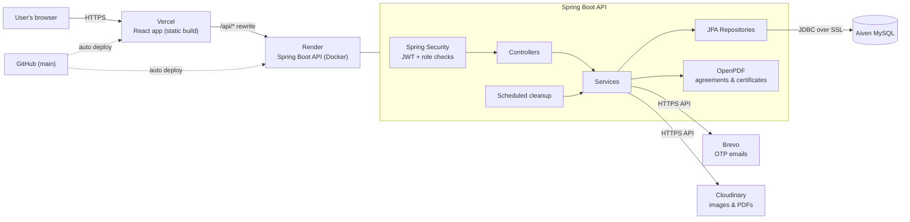

# PawFind — Pet Adoption Platform

**Live:** [pawfind-ten.vercel.app](https://pawfind-ten.vercel.app)

PawFind connects people looking to adopt with verified animal shelters (NGOs). Adopters browse and search pets, find shelters near them on a map, apply to adopt, and sign the adoption agreement online. NGOs manage their listings and applications, and admins verify NGOs before they go live.

> The backend runs on a free instance that sleeps when idle — the first request after a while can take about a minute.

## Features

- **Three roles** — Adopter, NGO and Admin, each with its own dashboard and access rules
- **Authentication** — JWT access/refresh tokens, email OTP verification, password reset, rate-limited OTP requests
- **Pet listings** — search and filters, multiple photos per pet, favorites
- **Nearby map** — pets and shelters around the user's location (Leaflet + OpenStreetMap)
- **NGO verification** — admins approve or reject NGOs; public NGO profile pages
- **Adoption workflow** — applications, NGO review, e-signed adoption agreement and adoption certificate as PDFs
- **Community** — public Q&A on pet listings, adopter success stories
- **Maintenance** — scheduled daily cleanup job, centralized exception handling

## Tech Stack

| Layer | Technologies |
|---|---|
| Frontend | React 18, Vite, React Router, Tailwind CSS, Axios, React Hook Form, React Leaflet, React Signature Canvas, Lottie |
| Backend | Java 21, Spring Boot 3.3, Spring Security, Spring Data JPA / Hibernate, Bean Validation, JJWT, OpenPDF, Lombok |
| Database | MySQL 8 |
| Services | Cloudinary (images & PDFs), Brevo API / SMTP (email) |
| Hosting | Vercel (frontend), Render — Docker (backend), Aiven (MySQL) |

## System Architecture



**Request flow:** the browser only talks to Vercel. Calls to `/api/*` are rewritten by Vercel to the Render backend, so the frontend uses the same relative `/api` paths locally and in production. The backend authenticates the JWT, applies role-based rules, and reads/writes MySQL; emails go out through Brevo's HTTPS API and media is stored on Cloudinary.

## Project Structure

```
pawfind/
├── backend/                 Spring Boot API
│   └── src/main/java/com/pawfind/
│       ├── config/          security rules, Cloudinary, admin seeder, cleanup scheduler
│       ├── security/        JWT generation and request filter
│       ├── controller/      REST endpoints (auth, pets, ngo, applications, ...)
│       ├── service/         business logic
│       ├── repository/      Spring Data JPA
│       ├── entity/          JPA entities and enums
│       ├── dto/             request/response objects
│       ├── exception/       centralized error handling
│       └── util/            helpers (e.g. geo distance)
├── frontend/                React (Vite) app
│   └── src/
│       ├── api/             Axios API clients
│       ├── components/      shared UI
│       ├── context/         auth context
│       └── pages/           public, adopter, ngo, admin pages
```

## Running Locally

**Prerequisites:** Java 21, Maven, Node 20+, MySQL 8

### Backend

1. Create `backend/src/main/resources/application-local.yml` :

   ```yaml
   spring:
     datasource:
       username: 'root'
       password: 'your-mysql-password'
     mail:
       username: 'you@gmail.com'
       password: 'gmail-app-password'   # used when BREVO_API_KEY is not set

   admin:
     email: 'admin@example.com'
     password: 'choose-an-admin-password'

   jwt:
     secret: 'a-random-string-of-at-least-32-characters'

   cloudinary:
     cloud-name: '...'
     api-key: '...'
     api-secret: '...'

   # BREVO_API_KEY: '...'               # optional: send mail via Brevo instead of SMTP
   ```

2. Start the API (the `local` profile is active by default and the `pawfind` database is created automatically):

   ```bash
   cd backend
   mvn spring-boot:run
   ```

   Runs on `http://localhost:8081`.

### Frontend

```bash
cd frontend
npm install
npm run dev
```

Runs on `http://localhost:5173`; the Vite dev server proxies `/api` to the backend.

## Deployment

| Part | Platform | Configuration |
|---|---|---|
| Frontend | Vercel | Root directory `frontend`; `frontend/vercel.json` rewrites `/api/*` to the backend and other paths to `index.html` |
| Backend | Render (Docker) | Root directory `backend`; configured entirely through environment variables |
| Database | Aiven MySQL | Connected via `SPRING_DATASOURCE_*` with `sslMode=REQUIRED` |

Backend environment variables:

| Variable | Purpose |
|---|---|
| `SPRING_PROFILES_ACTIVE` | `prod` |
| `SPRING_DATASOURCE_URL` / `_USERNAME` / `_PASSWORD` | MySQL connection |
| `BREVO_API_KEY`, `MAIL_USERNAME` | Email API key and verified sender address |
| `JWT_SECRET` | Token signing key (32+ characters) |
| `ADMIN_EMAIL`, `ADMIN_PASSWORD` | Admin account seeded on first start |
| `CLOUDINARY_CLOUD_NAME` / `_API_KEY` / `_API_SECRET` | Media storage |
| `CORS_ALLOWED_ORIGINS` | Frontend URL |
| `PORT` | `8081` |

Pushing to `main` redeploys both the frontend (Vercel) and the backend (Render).
